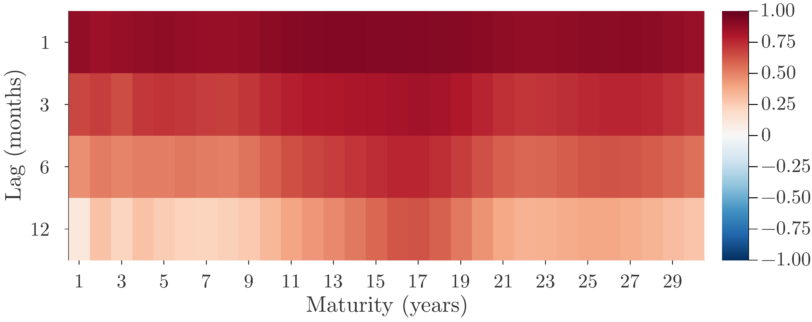

Bond researchers have long puzzled over why a model can fit the yield curve so closely and still miss in the same direction month after month. When the errors are tiny, it is easy to put them down to an imperfect model or to the limits of approximating an entire yield curve with a few factors.

I kept coming back to those errors in my own work on bonds. In an earlier study, I extracted factors from the errors and tested whether they helped forecast bond returns. Even when those factors captured much of the autocorrelation, I still wanted to know what made the errors persist in the first place. This paper grew out of that curiosity.

<!--more-->

Figure 1 shows the puzzle in U.S. Treasury data. Two principal components explain **99.77%** of the variance in monthly yields at maturities from one to thirty years. Yet the ten-year residual has a correlation of 0.90 with its value one month earlier and 0.60 with its value six months earlier.

> 

>   
> 

> 
 Figure 1. Autocorrelation of U.S. Treasury yield residuals after removing the first two principal components. Data: Filipović, Pelger, and Ye (2026), November 1985–June 2025. 

Suppose the Treasury issues more ten-year bonds than usual this month. Arbitrageurs require compensation to absorb the extra interest-rate risk, so the issue affects yields today. A month later those bonds have nine years and eleven months left. They still carry much the same risk as a new ten-year bond, so the original issue continues to affect the ten-year yield. I call this continuing influence the **issuance cohort effect**. It links yields across months even when new issues are independent.

I study this mechanism in the preferred-habitat model of Vayanos and Vila (2021), with balance-sheet costs as in He, Nagel, and Song (2022). I show analytically that as bonds age, they can generate strongly autocorrelated residuals at short lags even when a few factors explain almost all price variation. Solving the calibrated model numerically leads to the same conclusion.

For the derivations and the full results, see my paper, [*Bonds Age, Pricing Errors Persist*](https://econpreference.github.io/papers/Autocorr_Residuals.pdf).

## References

Lee, S. (2026), "Bonds Age, Pricing Errors Persist," Working Paper.

Filipović, D., Pelger, M., and Ye, Y. (2026), "Stripping the Discount Curve—A Robust Machine Learning Approach," Management Science, 72(9), 8057–8120.

Vayanos, D., and Vila, J.-L. (2021), ["A Preferred-Habitat Model of the Term Structure of Interest Rates,"](https://doi.org/10.3982/ECTA17440) Econometrica, 89(1), 77–112.

He, Z., Nagel, S., and Song, Z. (2022), ["Treasury Inconvenience Yields during the COVID-19 Crisis,"](https://doi.org/10.1016/j.jfineco.2021.05.044) Journal of Financial Economics, 143(1), 57–79.
